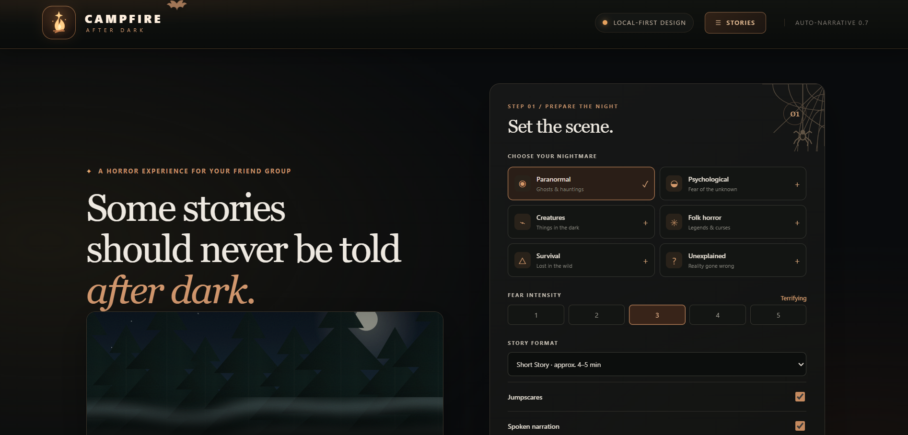
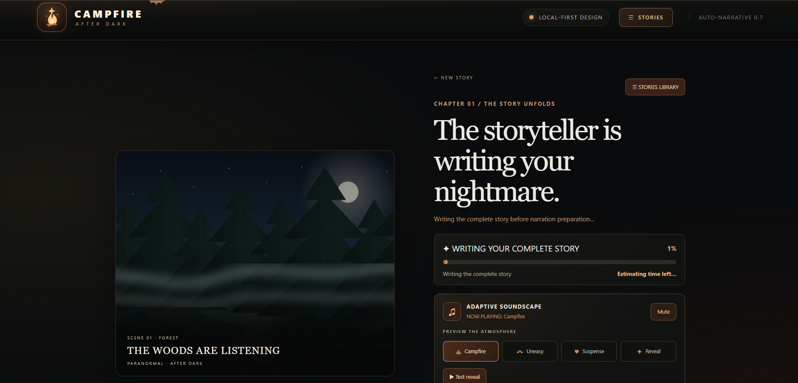
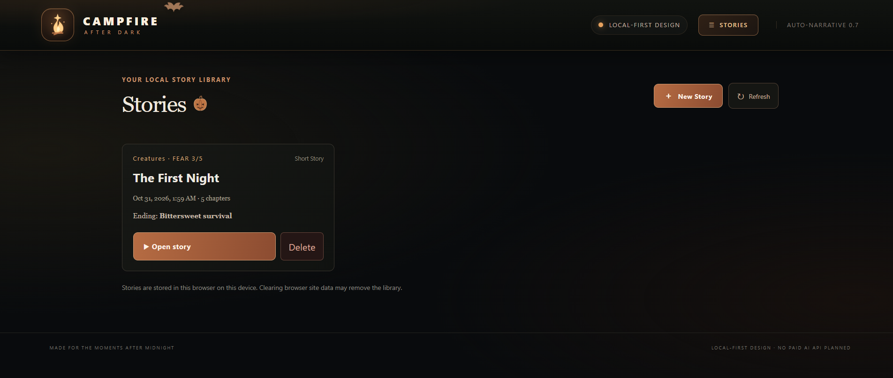

# 🔥 CAMPFIRE AFTER DARK

### Every story has an ending. Some endings follow you home.

**CAMPFIRE AFTER DARK** is an AI-powered horror storytelling experience that transforms generated stories into immersive, chapter-based adventures.

Create your own horror experience, choose how terrifying it becomes, and step into a world of atmospheric visuals, AI narration, eerie soundscapes and unexpected jump scares.

Built using React, Ollama and Kokoro ONNX, CAMPFIRE brings locally powered AI storytelling to your browser.

<p align="center">
  
</p>

---

## 📸 Application Screenshots

### Home Page



### Immersive Story Player



### Saved Stories


---

## ✨ Features

### AI-Powered Storytelling
- Generate original horror stories using a locally running language model.
- Choose from multiple horror genres:
  - Paranormal
  - Psychological
  - Creatures
  - Folk Horror
  - Survival
  - Unexplained
- Select the fear level, from unsettling to extremely terrifying.
- Choose between short and long story experiences.
- Generate complete stories with a beginning, escalating middle, climax and resolution.
- Experience different endings based on the selected fear level.

### Immersive Visual Storytelling
- Follow your story through individual chapters.
- Experience atmospheric scenes for forests, cabins, lakes, roads and other locations.
- View cinematic scene descriptions alongside the narration.
- Encounter frightening visual reveals when an entity appears.

### AI Narration
- Generate narration locally using Kokoro ONNX.
- Preview the narrator voice before starting a story.
- Listen to chapter narration as the story unfolds.
- Prepare narration audio for smooth chapter playback.

### Atmospheric Sound Design
- Ambient campfire crackling.
- Forest wind and environmental sounds.
- Ominous background drones.
- Heartbeat-like pulses.
- Location-specific sound effects.
- Sound-based jump scares, including whispers, cries, laughter and screams.

### Jump Scares
- Audio-only scares.
- Visual and audio scare combinations.
- Planned scare events throughout the story.
- Different scare assets to keep encounters from feeling repetitive.

### Story Library
- Save completed stories.
- Revisit previously generated stories.
- Replay individual chapters.
- Replay a complete story.
- Manage saved stories through the application dashboard.

---

## 🛠️ Technology Stack

| Technology | Purpose |
|---|---|
| React | Frontend user interface |
| Vite | Development server and build tooling |
| JavaScript | Application logic |
| CSS | Styling and visual effects |
| Ollama | Local AI inference |
| Qwen 3 4B Instruct | Horror story generation |
| Python | Narration server |
| FastAPI | Local narration API |
| Kokoro ONNX | Text-to-speech generation |
| IndexedDB | Browser-local story storage |
| Web Audio API | Narration playback and soundscapes |

---

## 🏗️ How It Works

CAMPFIRE uses two local AI services that work alongside the React frontend.

```text
                    USER
                      |
                      v
             REACT + VITE APP
                      |
             +--------+--------+
             |                 |
             v                 v
       OLLAMA SERVICE     KOKORO SERVICE
          :11434              :8000
             |                 |
             v                 v
        QWEN 3 4B          FASTAPI SERVER
             |                 |
             v                 v
       STORY GENERATION     NARRATION AUDIO
             |                 |
             +--------+--------+
                      |
                      v
             IMMERSIVE EXPERIENCE
       Visuals + Narration + Soundscapes
                      |
                      v
               STORY LIBRARY
                 IndexedDB
```

**Story generation:** The React application sends the story configuration to Ollama through the Vite development proxy. Qwen generates the complete story in structured JSON, which the frontend validates and converts into playable chapters.

**Narration:** The application sends chapter text to the local FastAPI server. Kokoro ONNX generates narration audio, which the browser plays alongside the story.

**Story storage:** Completed stories can be saved in the browser's IndexedDB database. They remain local to that browser profile rather than being uploaded to a cloud database.

---

# 🚀 Installation and Setup

Follow the instructions below to run CAMPFIRE on your own computer.

## 1. Prerequisites

Install the following software:

| Software | Download |
|---|---|
| Git | https://git-scm.com/downloads |
| Node.js and npm | https://nodejs.org/ |
| Python 3.12 (recommended) | https://www.python.org/downloads/ |
| Ollama | https://ollama.com/download |

Python 3.10–3.13 is supported by the current Kokoro ONNX package.

A computer with sufficient memory and processing power is recommended because the AI models run locally. GPU acceleration is optional; performance depends on your hardware and Ollama configuration.

## 2. Clone the Repository

Open a terminal and run:

```bash
git clone https://github.com/Aayush264/campfire-after-dark.git
```

Navigate into the project directory:

```bash
cd campfire-after-dark
```

## 3. Install Frontend Dependencies

Install the required Node.js packages:

```bash
npm install
```

This installs the dependencies declared in `package.json`.

## 4. Set Up Ollama

Install Ollama using the official installer.

Download the model used by CAMPFIRE:

```bash
ollama pull qwen3:4b-instruct
```

Verify that the model is installed:

```bash
ollama list
```

Make sure the Ollama service is running.

On systems where Ollama is not already running as a background service, start it with:

```bash
ollama serve
```

Ollama normally listens locally on:

```text
http://127.0.0.1:11434
```

Keep Ollama running while using CAMPFIRE.

## 5. Set Up the Kokoro Narration Server

Open a second terminal at the repository root.

Navigate to the voice server directory:

```bash
cd voice_server
```

### Create a Python virtual environment

**Windows PowerShell:**

```powershell
py -3.12 -m venv .venv
.venv\Scripts\Activate.ps1
```

**macOS / Linux:**

```bash
python3.12 -m venv .venv
source .venv/bin/activate
```

### Install Python dependencies

```bash
python -m pip install --upgrade pip
pip install fastapi uvicorn kokoro-onnx soundfile
```

### Download the Kokoro model files

The ONNX model and voice data are intentionally excluded from this Git repository because of their size.

Create the models directory:

```bash
mkdir models
```

Download these two files from the official Kokoro ONNX model release:

- `kokoro-v1.0.onnx`
- `voices-v1.0.bin`

Official model release:

https://github.com/thewh1teagle/kokoro-onnx/releases/tag/model-files-v1.1

**Windows PowerShell:**

```powershell
Invoke-WebRequest `
  -Uri "https://github.com/thewh1teagle/kokoro-onnx/releases/download/model-files-v1.1/kokoro-v1.0.onnx" `
  -OutFile "models/kokoro-v1.0.onnx"

Invoke-WebRequest `
  -Uri "https://github.com/thewh1teagle/kokoro-onnx/releases/download/model-files-v1.1/voices-v1.0.bin" `
  -OutFile "models/voices-v1.0.bin"
```

**macOS / Linux:**

```bash
curl -L "https://github.com/thewh1teagle/kokoro-onnx/releases/download/model-files-v1.1/kokoro-v1.0.onnx" -o models/kokoro-v1.0.onnx

curl -L "https://github.com/thewh1teagle/kokoro-onnx/releases/download/model-files-v1.1/voices-v1.0.bin" -o models/voices-v1.0.bin
```

Your directory should now look like this:

```text
voice_server/
│
├── models/
│   ├── kokoro-v1.0.onnx
│   └── voices-v1.0.bin
│
├── server.py
└── .venv/
```

### Start the narration server

Make sure the virtual environment is activated and that your terminal is inside `voice_server`.

Run:

```bash
python -m uvicorn server:app --host 127.0.0.1 --port 8000
```

The server should load the Kokoro model and report that it is ready.

Verify its health endpoint:

```text
http://127.0.0.1:8000/health
```

Keep this terminal running while using the application.

## 6. Start the CAMPFIRE Frontend

Open a third terminal.

Navigate to the repository root if you are not already there:

```bash
cd campfire-after-dark
```

Start the Vite development server:

```bash
npm run dev
```

Vite will display a local development address, usually:

```text
http://localhost:5173
```

Open that address in your browser.

---

## ▶️ Running CAMPFIRE

Before generating a narrated story, make sure these services are running:

| Service | Address / Command |
|---|---|
| Ollama | `127.0.0.1:11434` |
| Kokoro FastAPI | `127.0.0.1:8000` |
| React + Vite | `localhost:5173` |

The Vite configuration provides the local proxy routes used by the frontend to communicate with Ollama and the narration server.

You should keep all required services running while using the app.

---

## 📂 Project Structure

```text
campfire-after-dark/
│
├── public/
│   ├── audio/
│   │   └── Ambient sounds and scare effects
│   │
│   ├── scenes/
│   │   └── Scene illustrations and scare visuals
│   │
│   └── campfire-favicon.svg
│
├── src/
│   ├── assets/
│   ├── App.jsx
│   ├── App.css
│   ├── VisualStory.css
│   ├── index.css
│   └── main.jsx
│
├── voice_server/
│   ├── models/             # Download separately
│   └── server.py
│
├── docs/
│   └── screenshots/
│
├── index.html
├── eslint.config.js
├── package.json
├── package-lock.json
├── vite.config.js
├── .gitignore
└── README.md
```

---

## 🔧 Troubleshooting

### Ollama is not responding

- Make sure Ollama is installed and running.
- Check that `qwen3:4b-instruct` is installed using `ollama list`.
- Start Ollama again if its service has stopped.
- Check the Vite terminal for connection errors.

### Narration is not working

- Confirm the FastAPI server is running on port `8000`.
- Check that both Kokoro model files exist inside `voice_server/models/`.
- Open the `/health` endpoint to check whether the narrator is loaded.
- Check the Python server terminal for errors.

### Missing Kokoro model files

Make sure these exact filenames are present:

```text
kokoro-v1.0.onnx
voices-v1.0.bin
```

They must be located in:

```text
voice_server/models/
```

Restart the narration server after placing the files.

### Browser audio is not playing

- Check the system and browser volume.
- Make sure the audio controls are enabled.
- Allow playback after interacting with the application.
- Try a supported modern browser such as Chrome or Edge.

### Port already in use

Another application may already be using the required port. Stop the conflicting process or update the corresponding Vite proxy/server configuration consistently before changing the port.

---

## 🔐 Important Notes

- Ollama and Kokoro run as separate local services.
- AI model weights are not included in the Git repository.
- Python virtual environments and installed Node dependencies are not included.
- Saved stories are stored in browser-local IndexedDB. Clearing browser site data can remove locally saved stories.
- This repository provides the local development application. It does not provide a hosted AI inference service.

---

## 🤝 Contributing

Contributions, suggestions and improvements are welcome!

1. Fork this repository.
2. Create a feature branch.
3. Make your changes.
4. Test your changes locally.
5. Open a pull request with a description of your improvement.

Please avoid committing model weights, virtual environments, API credentials or other private configuration files.

---

## 👨‍💻 Author

**Aayush264**

GitHub: https://github.com/Aayush264

Project: https://github.com/Aayush264/campfire-after-dark

---

## ❤️ A Note

CAMPFIRE AFTER DARK is built around one idea:

**A horror story should not just be read. It should be experienced.**

Turn down the lights. Put on your headphones. Gather around the campfire.

And whatever you do...

**Don't look behind you.** 🔥
